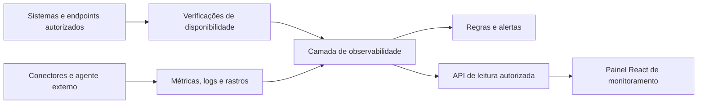
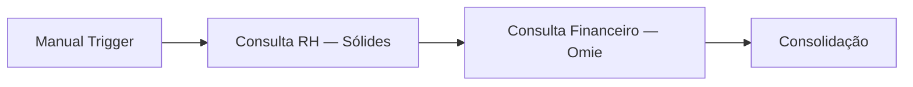

# Monitoramento do backoffice interno

Proposta de observabilidade para o projeto Gestão de custos. O contexto fornecido cita Grafana e Prometheus; isso não confirma sua implantação, seus acessos ou sua conexão a este front-end.

O responsável escolheu definir primeiro a arquitetura, as métricas e os sistemas monitoráveis. Este documento não implanta coleta, altera fornecedores, cria alertas ou adiciona uma tela ao site.

## O que acompanhar

| Camada          | Pergunta                                                  | Sinais propostos                                                                                                  |
| --------------- | --------------------------------------------------------- | ----------------------------------------------------------------------------------------------------------------- |
| Disponibilidade | O serviço responde a uma verificação válida?              | Resultado da verificação, latência, horário da última coleta e histórico de disponibilidade                       |
| Integração      | O conector está habilitado e consegue acessar sua origem? | Habilitada, pausada ou não configurada; autorização, limites de requisição e erros de comunicação                 |
| Automação       | A rotina concluiu o trabalho esperado?                    | Última execução e último sucesso, duração, falhas, tentativas e atraso de sincronização                           |
| Agente externo  | Qual etapa demorou ou falhou?                             | Identificador de execução e resultado de cada nó: Manual Trigger, Consulta RH, Consulta Financeiro e Consolidação |

“Ligado/desligado” precisa indicar o que está sendo observado. Um SaaS acessível pode ter uma integração pausada. Uma falha de autorização não comprova uma indisponibilidade do fornecedor. A ausência de uma execução do Manual Trigger também não comprova falha: o fluxo depende de uma solicitação.

## Estados e critérios

| Estado de saúde | Uso                                                                                |
| --------------- | ---------------------------------------------------------------------------------- |
| Disponível      | Uma verificação recente confirmou o resultado esperado para o alvo configurado     |
| Degradado       | Um limite acordado de latência ou erros foi ultrapassado                           |
| Indisponível    | Verificações válidas falharam conforme a regra de confirmação definida pela equipe |
| Em manutenção   | Há uma janela de manutenção declarada                                              |
| Sem telemetria  | Não há coleta configurada, o resultado é desconhecido ou a última coleta venceu    |

Configuração da integração é um campo distinto: **Habilitada**, **Pausada** ou **Não configurada**. Uma pausa não deve virar um incidente de indisponibilidade. Nenhum estado deve depender apenas da cor.

Quando essa configuração não for conhecida, mostrar **Não informado**. A ausência de integração do front-end ao monitoramento não comprova que o conector externo esteja desabilitado. A saúde da conexão também é separada da configuração: um conector habilitado pode apresentar falha de autorização, limite de requisições ou erro de comunicação.

Os intervalos de coleta, limites, quantidade de falhas para confirmar incidente, janela de disponibilidade e prazo de validade da coleta ainda precisam ser acordados. Uma coleta vencida deve indicar “Sem telemetria”; não pode continuar exibindo um resultado verde antigo. Valores ausentes são `null`, não zero.

## Cobertura possível

- **Sólides e Omie:** verificar os acessos autorizados disponíveis e instrumentar separadamente as requisições do agente ou dos conectores.
- **Agente externo:** obter telemetria da equipe responsável e correlacionar os quatro nós de uma mesma execução. O front-end não deve disparar o agente para testar disponibilidade sem um contrato específico.
- **Flash, Vixting e Clude:** acompanhar os conectores e as rotinas quando seus meios de integração forem confirmados.
- **SharePoint e Autentique:** acompanhar acesso, última execução e resultado do processo documental quando a rotina estiver disponível.
- **E-mails de fornecedores e Sindpd:** acompanhar o processo de recebimento, processamento ou envio; a existência de um endereço de e-mail não constitui uma verificação de saúde do fornecedor.
- **Alura e SENAI:** preservar as restrições já registradas. Não presumir API ou automação disponível para gerar telemetria.
- **Jurídico:** permanece fora das automações atuais; este documento não cria uma integração para ele.

Para serviços de terceiros, só é possível observar o que seus contratos, acessos e sinais autorizados permitem. Latência de API, resultado do conector e página pública de status são observações diferentes. CPU e memória de um SaaS não ficam disponíveis apenas porque o projeto o utiliza.

### Inventário inicial e prioridade proposta

Nenhum item abaixo tem coleta confirmada neste repositório. A classificação descreve o que levantar e observar, não o estado atual dos serviços.

| Sistema ou processo        | O que é candidato a monitoramento                                                                              | Dependência para confirmar a coleta                                                     | Prioridade proposta  |
| -------------------------- | -------------------------------------------------------------------------------------------------------------- | --------------------------------------------------------------------------------------- | -------------------- |
| Sólides                    | Resultado e latência da consulta RH; último acesso bem-sucedido; erros e limite de requisições do conector     | Acesso autorizado e telemetria da consulta externa                                      | P1                   |
| Omie                       | Resultado e latência da consulta financeira; último sucesso; erros e limites do conector                       | Acesso autorizado e telemetria da consulta externa                                      | P1                   |
| Agente externo             | Execuções, resultado, duração e erro de cada um dos quatro nós; correlação entre RH, Financeiro e Consolidação | Dados de execução, logs ou instrumentação disponibilizados pela equipe do agente        | P1                   |
| Front-end interno          | Disponibilidade da página e da futura API de leitura; erros de carregamento                                    | Alvo publicado e local de coleta definidos                                              | P1                   |
| Flash                      | Execuções e falhas dos cadastros de RH quando a automação estiver disponível                                   | Processo e integração de cadastro ainda a confirmar                                     | P2                   |
| Vixting → Sólides          | Cadastros, transferência de ponto/atestados, última sincronização e rejeições                                  | Fluxo, meios de integração e coleta ainda a confirmar                                   | P2                   |
| Clude                      | Execuções e falhas dos cadastros de RH quando a automação estiver disponível                                   | Processo e integração ainda a confirmar                                                 | P2                   |
| Autentique → SharePoint    | Resultado do backup, última execução, último sucesso e duração                                                 | Rotina de backup e evidência de execução disponibilizadas                               | P2                   |
| Relatórios RH → SharePoint | Resultado e horário da publicação dos relatórios esperados                                                     | Agenda, destino e verificação de publicação definidos                                   | P2                   |
| E-mail → Sólides           | Recebimento, processamento e rejeição de informações de Padizzi, Limpeza, VT Privado, Seguros e Ourho          | Fluxo de e-mail e importação a definir; não basta verificar o domínio do fornecedor     | P2                   |
| Sindpd                     | Resultado do processo de envio; falhas; devoluções quando houver evidência disponível                          | Serviço e rotina de e-mail a definir; envio aceito não comprova entrega ao destinatário | P2                   |
| SulAmérica / Wellhub       | Disponibilidade de eventual acesso autorizado e execução de processo que vier a ser definido                   | Não há rotina nem alvo de coleta confirmado                                             | Em levantamento      |
| Porto Seguro — vida        | Disponibilidade de eventual acesso autorizado e execução da rotina de seguro de vida                           | Processo e meio de acesso ainda a confirmar                                             | Em levantamento      |
| Alura                      | Andamento e pendências do fluxo manual de solicitação de licenças; possível alerta à Infra                     | Processo por e-mail; alerta ainda em avaliação, sem presumir automação direta           | Restrito ao processo |
| SENAI                      | Andamento do processo de matrícula, caso exista uma etapa observável acordada                                  | Análise dos formulários e da viabilidade de automação                                   | Em análise           |
| Jurídico                   | Nenhuma automação incluída nesta etapa                                                                         | Arquivo documental, conforme decisão de escopo                                          | Fora do escopo atual |

P1 propõe começar pelas dependências do caso de uso já documentado e pela interface de consulta. P2 depende da definição das automações. As prioridades precisam ser acordadas com os responsáveis; não representam compromisso de implantação.

### Infraestrutura e observabilidade

| Alvo adicional                                          | Cobertura a definir                                                                     | Condição                                                                                                             |
| ------------------------------------------------------- | --------------------------------------------------------------------------------------- | -------------------------------------------------------------------------------------------------------------------- |
| Coletores, armazenamento e API de observabilidade       | Disponibilidade da coleta, último sucesso de leitura e erros da própria observabilidade | Incluir na primeira implantação para identificar quando o monitoramento deixou de funcionar                          |
| Servidores dos conectores, se houver gestão pela equipe | Disponibilidade do host, CPU, memória, disco e serviços da aplicação                    | Depende de acesso à infraestrutura; não se aplica automaticamente aos servidores dos fornecedores SaaS               |
| GLPI / OCS Inventory                                    | Acesso e saúde de eventual integração de chamados ou inventário                         | Citados no contexto original; confirmar se fazem parte da cobertura atual antes de configurar alvos                  |
| Entra ID / AD                                           | Resultado dos fluxos de identidade utilizados pelas integrações                         | Confirmar provedor, acessos e sinais disponíveis; uma falha local de credencial não comprova falha global do serviço |

Para hosts sob gestão da equipe, o [Node Exporter](https://prometheus.io/docs/guides/node-exporter/) é uma opção para métricas de hardware e sistema operacional em sistemas compatíveis; o mesmo guia indica uma alternativa específica para Windows. A escolha depende do ambiente. A verificação de saúde da aplicação continua sendo uma observação distinta das métricas do host.

## Arquitetura proposta



A coleta deve continuar funcionando independentemente de alguém manter o site aberto. O front-end consulta resultados consolidados; credenciais das plataformas e rotinas de coleta pertencem à infraestrutura externa.

Como opção a validar, o [Blackbox Exporter do Prometheus](https://github.com/prometheus/blackbox_exporter) realiza verificações de endpoints por protocolos como HTTP e TCP. O [Prometheus](https://prometheus.io/docs/introduction/first_steps/) coleta métricas de alvos configurados. Essa escolha depende dos acessos e da operação da Infra.

O [OpenTelemetry](https://opentelemetry.io/docs/what-is-opentelemetry/) permite instrumentar métricas, logs e rastros nos serviços que a equipe controla. Os [rastros distribuídos](https://opentelemetry.io/docs/concepts/signals/traces/) ajudam a relacionar as etapas de uma execução; o serviço externo precisa disponibilizar essa instrumentação ou dados equivalentes.

O [Grafana Alerting](https://grafana.com/docs/grafana/latest/alerting/fundamentals/notifications/) permite encaminhar notificações de regras para destinos configurados. Canais, destinatários e critérios ainda precisam ser definidos; este repositório não cria alertas reais.

### Responsabilidades e limites das camadas

| Camada                | Responsabilidade proposta                                                                           | Responsável a envolver                             |
| --------------------- | --------------------------------------------------------------------------------------------------- | -------------------------------------------------- |
| Verificações externas | Executar verificações autorizadas em intervalos acordados, mesmo sem navegador aberto               | Infra e responsáveis pelos sistemas                |
| Instrumentação        | Expor métricas e eventos das rotinas e das etapas do agente                                         | Equipe das automações e do agente externo          |
| Histórico             | Armazenar séries temporais, registros e rastros; aplicar retenção                                   | Infra e responsáveis pelos dados                   |
| Regras e incidentes   | Avaliar falhas, manutenção, coleta vencida e recuperação; evitar notificações duplicadas            | Operação/Infra                                     |
| API de leitura        | Disponibilizar estados consolidados e dados autorizados para a interface                            | Equipe responsável pelo serviço de observabilidade |
| Front-end             | Consultar resultados, mostrar horário e origem, distinguir ausência de dados e estados operacionais | Equipe deste repositório                           |

OpenTelemetry só pode ser adotado onde houver suporte e controle suficientes para instrumentação. Não se presume que o Workflow Builder externo aceite instalar um SDK. Caso não aceite, a integração deverá usar os registros ou as interfaces de execução que a equipe responsável efetivamente disponibilizar.

## Catálogo de métricas

Os nomes abaixo são uma proposta de contrato interno para a coleta, não métricas já expostas pelos fornecedores. As janelas devem acompanhar o resultado exibido.

| Indicador                           | Fonte candidata                                       | Unidade e cálculo                                                                  | Contexto de leitura                                                                                   |
| ----------------------------------- | ----------------------------------------------------- | ---------------------------------------------------------------------------------- | ----------------------------------------------------------------------------------------------------- |
| Disponibilidade observada do alvo   | Verificações válidas do coletor                       | % = sucessos / verificações válidas × 100                                          | Exibir janela e cobertura; sem verificações válidas, resultado desconhecido                           |
| Latência de verificação p50/p95     | Histograma de duração das verificações                | Milissegundos na interface; segundos na coleta                                     | Percentil exige distribuição ou amostras adequadas; não calcular pela média de médias                 |
| Requisições                         | Contador do conector                                  | Total por janela ou requisições/segundo                                            | Identificar sistema, operação e janela                                                                |
| Taxa de erro das requisições        | Resultados do conector                                | % = requisições com falha / requisições observadas × 100                           | Distinguir comunicação, autorização, limite e resposta do serviço; sem requisições, taxa desconhecida |
| Falhas consecutivas de verificação  | Coletor de disponibilidade                            | Quantidade desde o último sucesso válido                                           | Apoiar confirmação de incidente, sem reagir a uma única falha transitória                             |
| Última coleta e idade da observação | Coletor                                               | Data/hora e segundos desde a observação                                            | Distinguir dado recente, vencido e nunca coletado                                                     |
| Último sucesso do processo          | Eventos da automação                                  | Data/hora da última execução concluída                                             | Não confundir com o último sucesso de uma verificação HTTP                                            |
| Resultado das execuções             | Eventos da automação/agente                           | Quantidades por estado: em execução, concluída, falhou, cancelada ou não executada | Usar identificador técnico de execução e janela                                                       |
| Taxa de sucesso de execuções        | Eventos de conclusão                                  | % = concluídas com sucesso / execuções finalizadas elegíveis × 100                 | Documentar se cancelamentos entram no denominador; não contar etapas puladas como novas execuções     |
| Duração da execução e de cada nó    | Eventos com início/fim ou rastros                     | Milissegundos/segundos; p50/p95 quando houver amostras                             | Separar espera, execução e duração total quando os dados permitirem                                   |
| Tentativas e reprocessamentos       | Eventos das automações                                | Quantidade por operação e janela                                                   | Distinguir tentativa de execução única para não inflar o volume de trabalho                           |
| Atraso da sincronização             | Evento de conclusão e referência esperada             | Minutos em relação ao horário/dado esperado                                        | Só aplicável a processos com agenda ou expectativa definida                                           |
| Pendências e rejeições              | Eventos de processamento ou fila disponível           | Quantidade por situação                                                            | Exibir apenas quando houver fonte de contagem; ausência de fonte não é fila vazia                     |
| Backup e publicação documental      | Evidência da rotina e verificação acordada do destino | Último sucesso, duração e quantidade esperada/realizada quando disponível          | Sucesso de envio não equivale a restauração de backup validada                                        |

Uma implementação com Prometheus pode adotar as [convenções de nomes e unidades](https://prometheus.io/docs/practices/naming/), com contadores de sufixo `_total` e histogramas de duração em `_seconds`, por exemplo `backoffice_requests_total` e `backoffice_operation_duration_seconds`. Esses nomes são propostos, não endpoints ou métricas existentes. O cálculo de p50/p95 depende das [distribuições de duração disponíveis](https://prometheus.io/docs/practices/histograms/). Rótulos devem ter valores controlados, como ambiente, sistema, operação e resultado; não usar CPF, texto de pergunta ou identificador de execução como rótulos de séries temporais.

### Telemetria do agente de quatro etapas



Cada execução deve permitir relacionar os quatro nós pelo mesmo identificador técnico. RH e Financeiro mantêm medições separadas de duração, resultado e tentativas. Consolidação tem seu próprio início, fim e resultado; não deve ser incorporada à duração da Omie.

Para cada nó, registrar quando disponível: execução, nome do nó, início/fim, situação, tentativa e categoria de erro. Se uma falha anterior impedir a consolidação, distinguir **Não executada** de **Falhou**, de acordo com o evento efetivamente informado pelo agente. Sem evento, usar **Desconhecido**.

Como o gatilho é manual, o simples fato de não haver novas execuções não caracteriza atraso nem indisponibilidade. A ausência de telemetria do coletor pode ser um problema de observabilidade; a ausência de solicitação ao agente é outra situação.

## Regras propostas para incidentes

| Situação                                        | Tratamento proposto                                                                                                      |
| ----------------------------------------------- | ------------------------------------------------------------------------------------------------------------------------ |
| Falha isolada de verificação                    | Registrar o evento; aguardar o critério de confirmação antes de declarar indisponibilidade                               |
| Falhas consecutivas de um alvo válido           | Confirmar incidente após a quantidade e a duração acordadas para esse alvo                                               |
| HTTP 401/403 do conector                        | Sinalizar falha de autorização da integração; não concluir que toda a plataforma está fora do ar                         |
| HTTP 429                                        | Sinalizar limitação de requisições e identificar o conector; não classificar automaticamente o fornecedor como desligado |
| Latência ou taxa de erro acima do limite        | Sinalizar degradação após a janela acordada, com amostra suficiente                                                      |
| Coleta vencida                                  | Mostrar Sem telemetria; alertar falha de observabilidade se a coleta deveria estar ativa                                 |
| Integração pausada ou alvo em manutenção        | Identificar a pausa/janela e ajustar alertas de execução esperada; manter a mudança registrada                           |
| Processo agendado sem sucesso no prazo esperado | Alertar atraso usando a agenda e a tolerância específicas do processo                                                    |
| Manual Trigger sem novas solicitações           | Não gerar incidente por inatividade                                                                                      |
| Recuperação confirmada                          | Encerrar o incidente e registrar duração; evitar abertura de múltiplos incidentes para a mesma falha contínua            |

Não há frequência, tolerância, SLA ou SLO aprovado neste documento. Esses parâmetros devem considerar contrato do fornecedor, limites de API, horário do processo e impacto para a equipe. Notificações só serão habilitadas depois de definir responsáveis, destinos, critérios e manutenção.

## Contrato de leitura proposto para o front-end

Uma API externa deverá consolidar a coleta e oferecer operações de leitura. Os caminhos abaixo são sugestões de contrato, não rotas já implementadas:

| Operação proposta                             | Conteúdo                                                                                |
| --------------------------------------------- | --------------------------------------------------------------------------------------- |
| `GET /observability/overview`                 | Resumo dos alvos e dos estados, janela, origem e horário dos dados                      |
| `GET /observability/systems`                  | Inventário, saúde observada, estado informado da integração e cobertura                 |
| `GET /observability/systems/{id}`             | Métricas e histórico autorizado de um alvo                                              |
| `GET /observability/executions/{executionId}` | Resultado da execução e de seus nós, quando a equipe externa disponibilizar esses dados |
| `GET /observability/incidents`                | Incidentes, recuperação e manutenção conhecidos                                         |

Exemplo de observação ainda não configurada:

```json
{
  "systemId": "solides",
  "targetKind": "integration",
  "mode": "live",
  "health": "unknown",
  "integrationState": "unknown",
  "observationReason": "not_configured",
  "source": null,
  "observedAt": null,
  "expiresAt": null,
  "windowSeconds": 3600,
  "metrics": {
    "availabilityPercent": null,
    "latencyP95Ms": null,
    "errorRatePercent": null,
    "lastSuccessfulExecutionAt": null
  }
}
```

`mode` identifica a origem real ou demonstrativa da resposta; `live` não significa que exista uma observação disponível. `integrationState: unknown` evita atribuir uma configuração ao conector externo sem informação. O exemplo não representa uma consulta real à Sólides.

Uma resposta com observação vencida deve expor a razão e, se necessário, o último estado conhecido separadamente. A interface não deve continuar mostrando verde apenas porque esse era o último estado recebido. Falha de acesso à API de observabilidade também não deve transformar todos os fornecedores em “Indisponíveis”.

O MVP de consulta não inclui controles para ligar/desligar fornecedores, pausar integrações ou reexecutar automações. Esses comandos exigiriam um escopo operacional próprio e não decorrem da criação de um painel de monitoramento.

## Informações necessárias à integração

1. Inventário dos sistemas e responsáveis, diferenciando sistemas, conectores e processos.
2. Alvos autorizados, resultado esperado de cada verificação e limites de coleta de cada fornecedor.
3. Acesso ao ambiente de observabilidade existente, caso haja, e ao responsável pelo agente externo.
4. Contrato de leitura para o front-end, incluindo horários, estados, ausência de dados e erros de coleta.
5. Acordo sobre os indicadores, manutenção e critérios de incidente, com uma primeira lista de alertas úteis.

O contrato deve fornecer origem e horário da observação, saúde do alvo, configuração da integração e métricas com unidades e janela de cálculo. Latência média, taxa de erro e disponibilidade só devem ser exibidas com sua janela identificada. Logs e rastros devem usar identificadores técnicos de correlação, sem incluir CPF completo, atestados ou credenciais.

## Etapas de entrega

1. Definir cobertura e critérios com a Infra e a equipe do agente.
2. Disponibilizar coleta externa e armazenamento de histórico.
3. Integrar a API de leitura e tratar carregamento, falhas e coleta vencida no front-end.
4. Validar incidentes e notificações em um cenário controlado antes da operação real.

O escopo atual deste repositório continua sendo front-end. Uma tela com dados simulados deve identificá-los claramente e não representar uma confirmação do estado real dos fornecedores.

## Critérios de validação da primeira coleta real

- Demonstrar um sucesso e uma falha controlada de uma verificação autorizada.
- Distinguir falha de autorização, indisponibilidade do alvo e ausência de telemetria.
- Demonstrar uma observação vencida sem preservar o verde como estado atual.
- Correlacionar uma execução do agente aos quatro nós sem misturar a duração das consultas e da consolidação.
- Demonstrar que pausa, manutenção e inatividade do Manual Trigger não produzem incidentes indevidos.
- Conferir cálculos, unidades, janela e denominadores das métricas com a mesma fonte consumida pela interface.
- Confirmar que notificações chegam aos destinos acordados e que a recuperação encerra o mesmo incidente.
